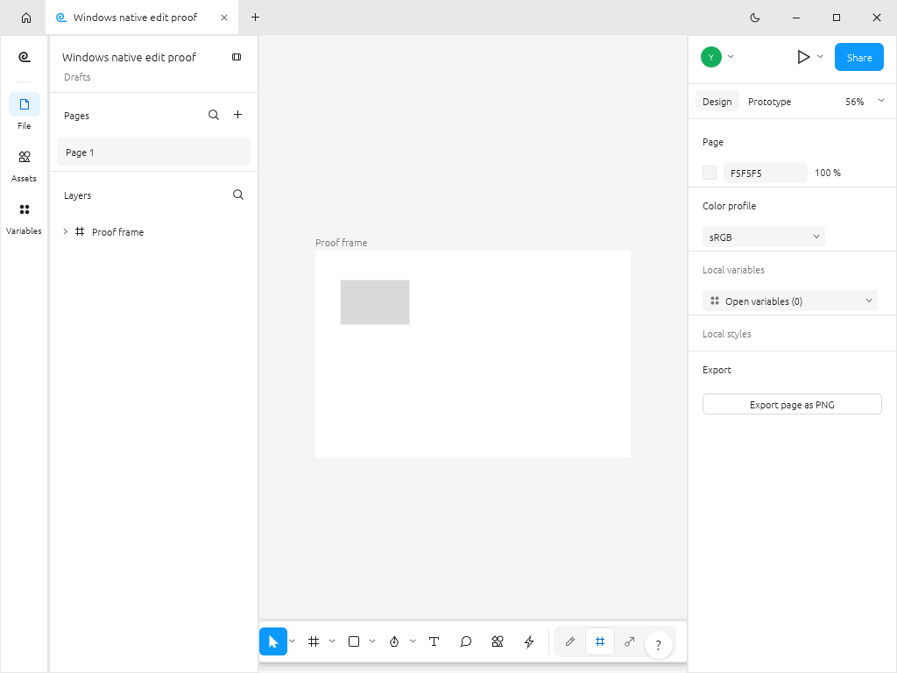
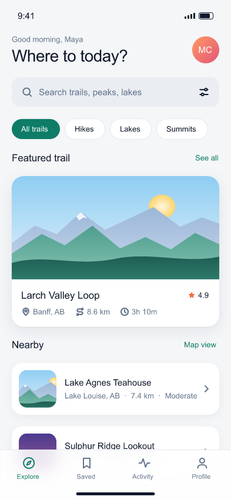

<p align="center">
  
</p>

<p align="center">
  
</p>
<p align="center"><strong>Published by PWDS</strong></p>
<h1 align="center">FigStrike</h1>

**Open-source interface design and prototyping in Rust.** Create screens on a native canvas, build reusable design systems, and automate document work through the same command engine used by the editor.

FigStrike is an independent early-alpha application built on a complete Rust design-editor foundation. The codebase includes a native egui editor, document engine, CLI, browser frontend, and collaboration service. The capabilities below describe the source; [the validation section](#validation-status) shows what this fork has actually exercised.

**Status:** early alpha, available as a source build. No public installer or release is offered here yet.

## Rust direction and migration status

- **Target:** Rust-native interface design and prototyping, extending the selected FigCraft foundation rather than rewriting an already-Rust application.
- **Current implementation:** The [Cargo workspace](Cargo.toml) and [desktop entry point](apps/figcraft/src/main.rs) already use Rust, with the selected document engine, native editor, CLI, browser frontend and collaboration-service source.
- **Remaining migration:** Continue integration and runtime acceptance on this base. Representative external files, collaboration, broader pointer editing, browser/platform builds and installers remain unverified; source-present features are not completed product acceptance.

## Native UI preview


*Unmodified 1024×768 native frame captured on a standard hosted Windows 2025 runner on 23 October 2026 in [successful run 40019695994](https://github.com/Gerbzz/FigStrike/actions/runs/40019695994), exact source `18bbdce4af399c508612ecbad0a61e794ba710b9`. The real native design editor after keyboard-editing a rectangle, saving, and reopening the synthetic document. [Source, hashes and limits](docs/evidence/figstrike-windows-native-edited-20261023.provenance.json).*

Synthetic frame/rectangle workflow only; broader pointer editing, collaboration and external document compatibility remain unverified. Runtime and packaged icons are unchanged.

<details>
<summary>Earlier native capture and its original provenance</summary>



*The actual FigStrike desktop editor captured on 2026-10-15 on a hosted Windows 2025 runner. A selected rectangle was moved with the UI's ArrowRight shortcut, saved as `.figcraft`, and reopened in a second native process. [See the exact before/after values](docs/evidence/figstrike-windows-native-edit-verification.json) and [the green run](https://github.com/Gerbzz/FigStrike/actions/runs/38760286187).*

</details>

## Features

- **Design on a canvas:** frames, layers, vector shapes, text, alignment, and auto layout.
- **Build reusable systems:** components and variants, styles, variables, and libraries in the document model.
- **Connect screens:** prototype interactions and preview paths are present in the application.
- **Keep your files:** the native `.figcraft` format and command IDs remain compatible with the underlying open-source application. PNG, SVG, and PDF exports have been exercised on synthetic documents.
- **Automate the same engine:** the desktop UI, CLI, and local JSON control channel dispatch shared commands. See the [CLI guide](docs/cli.md) and [control protocol](docs/control-protocol.md).



*A pixel-exact crop of one mobile screen from the Windows CLI export of the included synthetic Ridgeline example. The [uncropped multi-artboard export](docs/evidence/figstrike-windows-ridgeline.png) is retained as provenance. This is a document render, not a capture of the editor UI. Artwork and source attribution are in [ATTRIBUTION.md](ATTRIBUTION.md).*

## Build and install

Install Rust 1.95 or newer and the native graphics/windowing libraries for your OS. This repository retains the internal `figcraft` package and binary names and the `.figcraft` file extension for compatibility.

```sh
git clone https://github.com/Gerbzz/FigStrike.git
cd FigStrike
cargo build --locked -p figcraft -p figcraft-cli
cargo run --locked -p figcraft -- examples/ridgeline-app.figcraft
cargo run --locked -p figcraft-cli -- info examples/ridgeline-app.figcraft
cargo run --locked -p figcraft-cli -- export examples/ridgeline-app.figcraft -o exports/ --format png
```

The build commands produce source builds, not signed or packaged installers. On Linux, the desktop runner used `libxkbcommon-x11` with a software graphics display; your distribution may require its corresponding windowing and graphics packages. For the architecture and supported command surface, see [docs/architecture.md](docs/architecture.md), [docs/cli.md](docs/cli.md), and [docs/control-protocol.md](docs/control-protocol.md).

## Validation status

| Workflow | Evidence |
| --- | --- |
| Native Windows editor | The full desktop binary built, opened a saved document, and rendered a visible window. A later [native edit run](https://github.com/Gerbzz/FigStrike/actions/runs/38760286187) created a rectangle, moved it from x=50 to x=51 through `ui.key`, saved it, and reopened it with identical geometry. |
| Document and export | A [Windows workflow](https://github.com/Gerbzz/FigStrike/actions/runs/38746168229) created and reopened a `.figcraft` file, exported PNG/SVG/PDF with selectable PDF text, rendered the 349-node Ridgeline example, and passed 17 CLI integration tests. |
| Linux first run | A [hosted Ubuntu run](https://github.com/Gerbzz/FigStrike/actions/runs/38739905782) launched the real first-run window with the approved PWDS mark. |

These checks use synthetic files. Representative external Figma files, multi-user collaboration, broader pointer editing, high-DPI behavior, macOS and browser builds, and installers still need validation. **No public installer or release is offered here yet.** The earlier native-edit capture retained in the historical block was produced from code reviewed in [PR #1](https://github.com/Gerbzz/FigStrike/pull/1). The new 2026-10-23 basic rectangle edit/save/reopen proof comes from [PR #5](https://github.com/Gerbzz/FigStrike/pull/5), source `18bbdce4af399c508612ecbad0a61e794ba710b9`, in [run 40019695994](https://github.com/Gerbzz/FigStrike/actions/runs/40019695994). Read the [verification ledger](docs/FIGSTRIKE_STATUS.md) for the current scope and gaps.

## Credits and licenses

The full application foundation is pinned to [FigCraft commit `102404e8c3d23d86c3490c1a6beff3202bb73e25`](https://github.com/storytold/figcraft/commit/102404e8c3d23d86c3490c1a6beff3202bb73e25). FigStrike is an independent modified fork. The original software copyright, [MIT](LICENSE-MIT) and [Apache-2.0](LICENSE-APACHE) licenses, and [NOTICE](NOTICE) remain; images and other assets are credited in [ATTRIBUTION.md](ATTRIBUTION.md). The inherited permissively licensed chameleon app icon is temporary and is not the FigStrike mark.

FigStrike is published by PWDS. The PWDS mark has [separate brand terms](assets/branding/LICENSE-brand.txt). FigStrike is not affiliated with or endorsed by ArtCraft or Figma.

## Product artwork

The FigStrike product mark above has an original [SVG master](assets/branding/FigStrike-logo.svg) and matching PNG. [Asset provenance](assets/branding/FigStrike-logo.provenance.json) records how it was created and the exact file hashes. The PWDS publisher artwork and inherited software credits are unchanged. Existing screenshots retain the artwork visible in their original captured builds.
